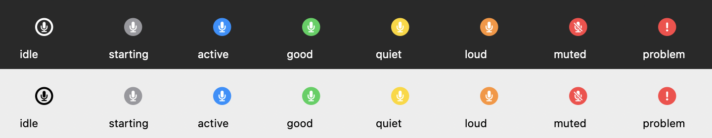

# CallLift

**Your microphone is too quiet in calls, and nothing in the settings makes it louder. CallLift does.**

CallLift is a small macOS menu bar app. It takes your microphone, raises its level (with a limiter, so nothing distorts)
and hands the result to your call app through a virtual microphone ([BlackHole](https://github.com/ExistentialAudio/BlackHole)).
The menu bar icon shows **live** whether your voice reaches a good level.

## Privacy, architecture and ways out

**Your microphone stays on your Mac.**

- **No internet access.** CallLift contains no networking code and opens no network connections (check yourself:
  `lsof -i -a -p $(pgrep -x CallLift)` prints nothing; a firewall such as LuLu can block it with no effect on function).
  No telemetry, no accounts, no auto-update. The only web link (BlackHole's project page) opens in your browser when you click it.
- **Microphone only during calls.** CallLift opens your microphone only while an app is reading the virtual microphone,
  and closes it 3 s after that app stops. Outside calls the macOS orange microphone indicator shows no CallLift activity.
- **Nothing is recorded.** Audio passes through memory only (about 15 ms of buffer). The log file
  (`~/Library/Logs/CallLift.log`) contains device names and state changes, never audio.
- **Built on your Mac from source** you can read: about 1,200 lines of Swift, no third-party code, no bundled drivers,
  no kernel extensions. BlackHole is a separate, open-source project you install yourself.

**Architecture**

```
your microphone ──► CallLift (menu bar app, runs as you, started at login)
                     ├─ Core Audio input callback: gain + look-ahead limiter (real-time thread)
                     ├─ lock-free ring buffer, resampler with clock-drift control (e.g. 16 kHz → 48 kHz)
                     └─ Core Audio output callback ──► BlackHole 2ch (virtual device) ──► your call app's microphone
```

**Ways out (all reversible)**

| You want to | Do |
|---|---|
| Stop it now | menu → **Quit CallLift** (stays off until next login) |
| No boost, keep it running | menu → Boost → **0 dB** |
| Use your headset directly again | in your call app, set the microphone back to the headset |
| Take away its microphone access | System Settings → Privacy & Security → Microphone → **CallLift** off |
| Remove it completely | `./install.sh --uninstall`, delete `~/Applications/CallLift.app` (see [Uninstall](#uninstall)) |
| Remove the virtual device | `brew uninstall --cask blackhole-2ch` |

It was built for one specific, common setup and tested there:

> **Mac + Citrix Workspace → Windows virtual desktop → Zoom with the Zoom VDI media plugin, Bluetooth earbuds (Jabra Elite 10)**
> "Your volume is very low" — but only with the headset, and no Zoom, Citrix or macOS setting fixes it.

## Why the mic is too quiet

**Zoom and its VDI media plugin carry most of the blame.** Your microphone reaches Zoom below the level Zoom itself
calls good, and in the VDI setup Zoom has no working way to raise it: no digital input normalization, an input slider
that does nothing, and an auto-volume that can only turn the level down. This also happens with the MacBook's own
microphone and Apple's default processing, so it is not one headset's fault. CallLift is the missing gain stage.

Each issue is documented separately with measurements in [FINDINGS](FINDINGS/README.md):

1. [No input level normalization in Zoom's VDI path](FINDINGS/01-zoom-no-input-normalization.md): main cause
2. [Apple's voice processing boosts only the built-in mic](FINDINGS/02-apple-voice-processing-builtin-only.md): why the headset was worse than the laptop
3. [Zoom's input volume slider has no effect in VDI](FINDINGS/03-zoom-vdi-input-slider-no-effect.md)
4. [Zoom's auto-volume only lowers, and the lowered level sticks](FINDINGS/04-zoom-auto-volume-only-lowers.md)
5. [Personalized audio isolation removes a Bluetooth earbud voice](FINDINGS/05-zoom-personalized-isolation-removes-voice.md)
6. [Original sound + macOS Voice Isolation costs 10 dB](FINDINGS/06-original-sound-plus-voice-isolation.md)
7. [Zoom VDI user interface shows stale state](FINDINGS/07-zoom-vdi-ui-stale.md)
8. [Bluetooth call mode: 16 kHz and a 2–4 s switch](FINDINGS/08-bluetooth-call-mode.md)
9. [macOS falls back to a virtual device when the headset disconnects](FINDINGS/09-macos-fallback-to-virtual-device.md)
10. [What was ruled out, and what is still open](FINDINGS/10-ruled-out-and-open.md)
11. [The headset fades words in over about 100 ms](FINDINGS/11-jabra-word-start-fade-in.md): weak sentence starts and short words

## What CallLift does

```
microphone (e.g. Bluetooth headset) → CallLift: +boost, limiter at −1 dBFS → BlackHole 2ch → call app → meeting
```

- **Boost** 0 to +24 dB (default +20 dB, tuned so normal speech reaches Zoom's green zone), **look-ahead limiter** so loud moments never clip.
- **Live voice feedback** in the menu bar: blue = active, not talking · green = good level · yellow = too quiet · orange = too loud (limiter working hard) · red = problem.
- **Runs only while an app listens** to the virtual microphone; outside calls it touches no microphone, so a Bluetooth headset stays in music quality.
- **Follows the macOS default input**, or a fixed microphone. If the microphone **disconnects**, CallLift sends silence and turns red instead of silently switching to the laptop mic; it resumes when the headset is back.
- **Safety checks**: red icon + notification when microphone access is missing or the mic stops delivering audio.
- **Keeps input volumes at 100%** (optional), because a lowered slider stays lowered.
- About **22 ms** extra delay (measured), constant; clock drift between devices is compensated.
- **Statistics** window (live level, limiter, delay, dropouts) and a built-in **"How CallLift works"** help.



## Requirements

- macOS 15 or later, Apple Silicon (the build targets arm64)
- Xcode Command Line Tools (`xcode-select --install`) for `swiftc`
- [BlackHole 2ch](https://github.com/ExistentialAudio/BlackHole) virtual audio device, e.g. via [Homebrew](https://brew.sh)

## Install

```bash
brew install --cask blackhole-2ch
sudo killall coreaudiod            # or log out and in, so the new device appears
git clone https://github.com/nuschpl/CallLift.git
cd CallLift/calllift && ./install.sh
```

BlackHole only adds an extra, silent audio device: your normal speakers and microphones keep working as before, and nothing goes through BlackHole unless an app (or you, in Sound settings) selects it; the one exception we saw is that macOS itself may switch its default input or output to a BlackHole device when your current headset disconnects (CallLift ignores that switch for its own microphone, but other apps set to "same as system" follow it until the headset is back).

`install.sh` builds the app into `~/Applications/CallLift.app` and starts it at every login. Allow microphone access
when macOS asks. CallLift is signed locally (ad-hoc), so macOS asks again after every rebuild.

## Setup recipes

Each recipe lists **every** relevant setting on both sides (call app inside the virtual desktop and the Mac), what must be
**off** and why, and what was measured. Pick the one that matches your setup:

| Recipe | Status |
|---|---|
| [Mac + Citrix (Windows desktop) + Zoom VDI media plugin](calllift/docs/recipes/zoom-citrix-vdi.md) | **tested** |
| Teams in Citrix (HDX RTC engine), native Zoom / Teams / Meet / Webex, Windows VMs (Parallels, VMware) | not tested yet |

Any app that can pick "BlackHole 2ch" as its microphone should work. Apps that only use the Mac's **default** input
(some VMs, Citrix without a media plugin) need the default input set to BlackHole 2ch and CallLift set to
**Microphone → Always use: <your mic>**. Reports and new recipes welcome.

## Uninstall

```bash
cd CallLift/calllift && ./install.sh --uninstall
rm -rf ~/Applications/CallLift.app
```

Switch your call app's microphone back to the headset first, then remove CallLift in System Settings → Privacy & Security → Microphone.

## Limitations

- Bluetooth headsets on a Mac use call mode (HFP, 16 kHz) whenever the microphone is in use. CallLift fixes loudness, not the frequency range.
- Starting a call switches the headset to call mode, which takes 2–4 s (Bluetooth); CallLift's own delay is about 22 ms.
- The boost also raises anything your microphone does not suppress itself; use the call app's noise suppression.

## License

GPL-3.0-or-later, see [LICENSE](LICENSE). Before contributing code, please open an issue first: contributions may need a
contributor agreement so the project can also be distributed in other ways (for example an App Store build).
BlackHole is a separate project under its own license and is not bundled.
