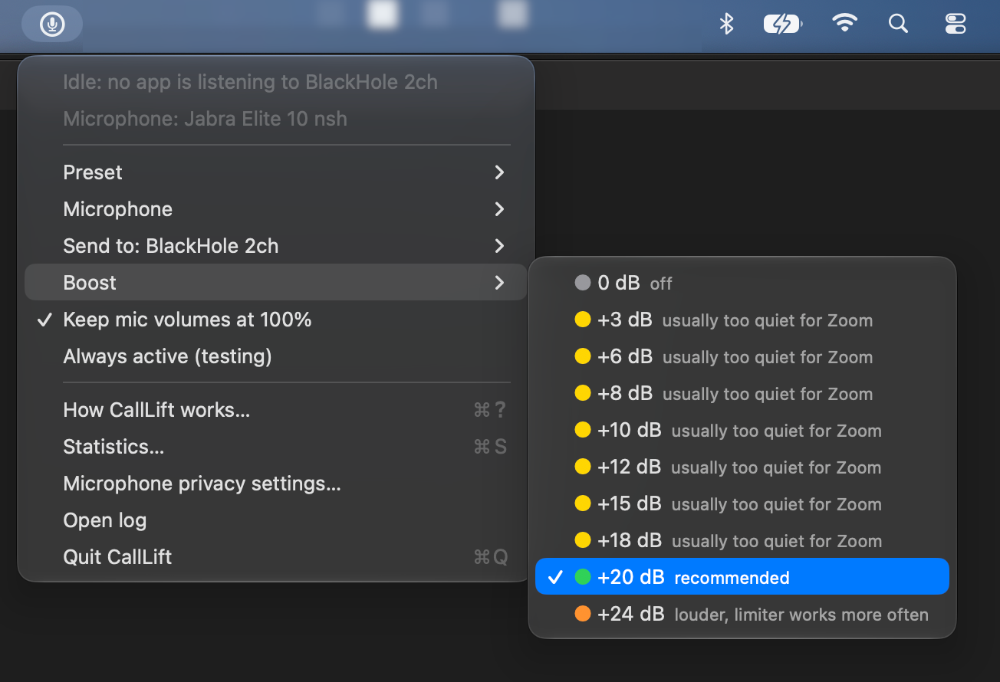

# CallLift

**Your microphone is too quiet in calls, and nothing in the settings makes it louder. CallLift does.**

CallLift is a small macOS menu bar app. It takes your microphone, raises its level (with a limiter, so nothing distorts)
and hands the result to your call app through a virtual microphone ([BlackHole](https://github.com/ExistentialAudio/BlackHole)).
The menu bar icon shows **live** whether your voice reaches a good level.

It was built for one specific, common setup and tested there:

> **Mac + Citrix Workspace → Windows virtual desktop → Zoom with the Zoom VDI media plugin, Bluetooth earbuds (Jabra Elite 10)**
> "Your volume is very low" — but only with the headset, and no Zoom, Citrix or macOS setting fixes it.

## Why the mic is too quiet (measured, not guessed)

- With Zoom's media plugin, Zoom on the **Mac** captures the microphone directly; Citrix does not carry the audio at all.
- Normal speech through the earbuds reached Zoom at about **−25 dBFS** on the loudest moments. Zoom's own level meter
  only turns green from about **−19 dBFS**: the voice arrives roughly **10 dB below** what Zoom considers good.
- Nothing in the chain can raise it: the Mac input slider tops out at 100% (unity), Zoom's input slider in the
  Citrix/VDI window **has no effect** (it only mirrors the Mac value), and Zoom's "automatically adjust microphone
  volume" only ever turned the level **down** (and the lowered Mac slider stayed low afterwards).
- The MacBook's built-in mic arrives at a similar raw level, so this is not a defect of one headset.
- Settings that make it worse: Zoom "Personalized audio isolation" removed the earbud voice almost completely;
  Zoom "Original sound" combined with macOS "Voice Isolation" cost about −10 dB.

## What CallLift does

```
microphone (e.g. Bluetooth headset) → CallLift: +boost, limiter at −1 dBFS → BlackHole 2ch → call app → meeting
```

- **Boost** 0 to +24 dB (default +20 dB, tuned so normal speech reaches Zoom's green zone), **look-ahead limiter** so loud moments never clip.
- **Live voice feedback** in the menu bar: blue = active, not talking · green = good level · yellow = too quiet · orange = too loud (limiter working hard) · red = problem.
- **Runs only while an app listens** to the virtual microphone; outside calls it touches no microphone, so a Bluetooth headset stays in music quality.
- **Follows the macOS default input**, or a fixed microphone. If the microphone **disconnects**, CallLift sends silence and turns red instead of silently switching to the laptop mic; it resumes when the headset is back.
- **Safety checks**: red icon + notification when microphone access is missing or the mic stops delivering audio.
- **Keeps input volumes at 100%** (optional), because a lowered slider stays lowered.
- About **22 ms** extra delay (measured), constant; clock drift between devices is compensated.
- **Statistics** window (live level, limiter, delay, dropouts) and a built-in **"How CallLift works"** help.


## Requirements

- macOS 15 or later, Apple Silicon (the build targets arm64)
- Xcode Command Line Tools (`xcode-select --install`) for `swiftc`
- [BlackHole 2ch](https://github.com/ExistentialAudio/BlackHole) virtual audio device, e.g. via [Homebrew](https://brew.sh)

## Install

```bash
brew install --cask blackhole-2ch
sudo killall coreaudiod            # or log out and in, so the new device appears
git clone https://github.com/nuschpl/CallLift.git
cd CallLift/calllift && ./install.sh
```

BlackHole only adds an extra, silent audio device: your normal speakers and microphones keep working as before, and nothing goes through BlackHole unless an app (or you, in Sound settings) selects it; the one exception we saw is that macOS itself may switch its default input or output to a BlackHole device when your current headset disconnects (CallLift ignores that switch for its own microphone, but other apps set to "same as system" follow it until the headset is back).

`install.sh` builds the app into `~/Applications/CallLift.app` and starts it at every login. Allow microphone access
when macOS asks. CallLift is signed locally (ad-hoc), so macOS asks again after every rebuild.

## Setup recipes (presets)

### Mac + Citrix (Windows) + Zoom media plugin — tested

CallLift: **Preset → Mac + Citrix (Windows) + Zoom media plugin** (default).

In Zoom inside the Citrix desktop (Settings → Audio):

| Setting | Value |
|---|---|
| Microphone | **BlackHole 2ch** |
| Speaker | your headset, or "Same as system" (never BlackHole 2ch) |
| Microphone modes | **Noise removal** (removes keyboard and background noise the boost makes audible) |
| Automatically adjust microphone volume | **off** |
| Advanced → Echo cancellation | Low (least processing with earbuds) |

On the Mac: System Settings → Sound → Input = your headset (CallLift follows it); Control Center → Mic Mode for Zoom = Standard.

### Other setups — not tested yet

Teams in Citrix (Citrix HDX RTC engine), native Zoom / Teams / Meet / Webex on the Mac, Windows VMs (Parallels, VMware):
any app that can pick "BlackHole 2ch" as its microphone should work. Apps that only use the Mac's **default** input
(some VMs, Citrix without a media plugin) need the default input set to BlackHole 2ch and CallLift set to
**Microphone → Always use: <your mic>**. Reports welcome.

## Uninstall

```bash
cd CallLift/calllift && ./install.sh --uninstall
rm -rf ~/Applications/CallLift.app
```

Switch your call app's microphone back to the headset first, then remove CallLift in System Settings → Privacy & Security → Microphone.

## Limitations

- Bluetooth headsets on a Mac use call mode (HFP, 16 kHz) whenever the microphone is in use. CallLift fixes loudness, not the frequency range.
- Starting a call switches the headset to call mode, which takes 2–4 s (Bluetooth); CallLift's own delay is about 22 ms.
- The boost also raises anything your microphone does not suppress itself; use the call app's noise suppression.

## License

GPL-3.0-or-later, see [LICENSE](LICENSE). Before contributing code, please open an issue first: contributions may need a
contributor agreement so the project can also be distributed in other ways (for example an App Store build).
BlackHole is a separate project under its own license and is not bundled.
